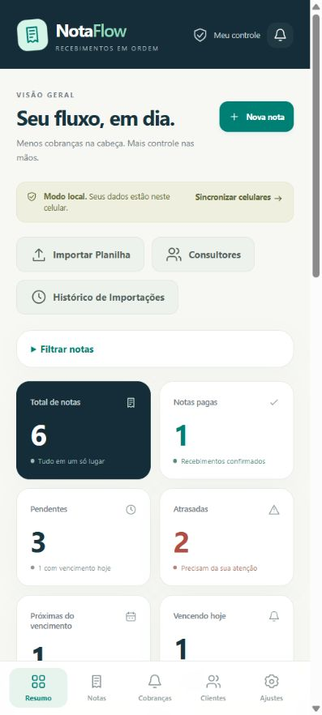
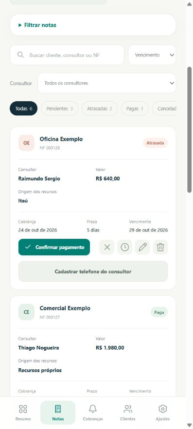
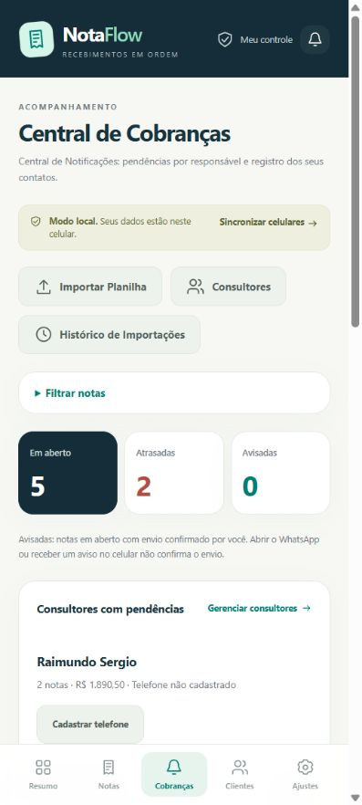
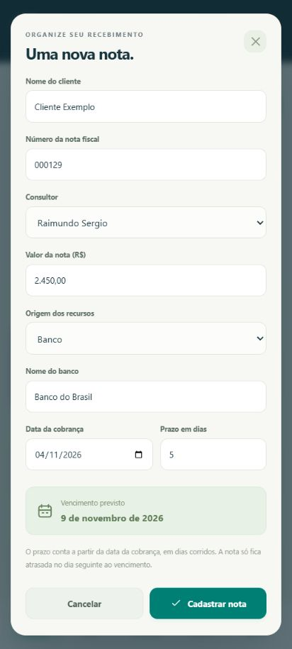

# NotaFlow

Aplicativo Android para controlar notas fiscais, valores, bancos ou recursos próprios, consultores, vencimentos e pagamentos. Inclui painel, notificações do celular, importação de Excel/CSV e Central de Cobranças com abertura manual do WhatsApp.

A versão 2.0 está em desenvolvimento. A sincronização entre celulares depende da configuração do Supabase descrita em [backend/README.md](backend/README.md). Nenhum servidor remoto ou envio automático de WhatsApp está ativado.


## Novidades desta Versão (Atualizações Recentes)

Esta versão inclui os novos recursos solicitados para automação de cobranças e importação:

1. **Notificações de Atraso de Notas Fiscais**:
   - Canal de alertas com prioridade alta (`IMPORTANCE_HIGH`), som e vibração no Android (`br.com.notaflow.ReminderJob`).
   - Identificação automática de notas com prazo vencido e emissão de alerta no sistema:
     * Alerta em vermelho com contagem de NFs atrasadas e identificação do cliente e número da NF.
     * Alerta em amarelo para notas vencendo no dia.
   - Botão de verificação imediata (*"Verificar Atrasos Agora"*) e rotina em segundo plano.

2. **Importação Avançada de Planilhas (`.xlsx`, `.xls`, `.csv`)**:
   - Mapeamento e extração inteligente das seguintes colunas:
     * **Nome do Cliente** (`client_name`)
     * **Data de Emissão e Vencimento** (`billing_date`, `due_date`)
     * **Número da NF** (`nf_number`)
     * **Nome do Consultor** (`consultant_name`)
     * **E-mail do Consultor** (`consultant_email`) — vinculado automaticamente ao cadastro do consultor
     * **Valor da Nota Fiscal** (`amount` em R$)
     * **Origem do Recurso** (`funding_source` — banco selecionado ou Recursos Próprios)
   - Criação/atualização automática do cadastro de consultores com seus respectivos e-mails.

3. **Disparo de Notificações por E-mail e WhatsApp**:
   - Central de Cobranças e painel com botões de ação rápida para cada NF:
     * **E-mail**: Dispara o aplicativo de e-mail padrão do Android com assunto e mensagem formal pré-formatados com todos os dados da NF, valor, vencimento, dados bancários e consultor responsável.
     * **WhatsApp**: Abertura direta com mensagem pré-configurada de lembrete/cobrança.
   - Registro de histórico de disparos de e-mail no aplicativo.

## Telas do app

Capturas da interface no navegador, em formato de celular, com dados fictícios. Clique em uma imagem para ampliá-la.

<table>
  <tr><th>Painel de acompanhamento</th><th>Notas e pagamentos</th></tr>
  <tr>
    <td><a href="docs/images/resumo.jpg"></a></td>
    <td><a href="docs/images/notas.jpg"></a></td>
  </tr>
  <tr><th>Central de Cobranças</th><th>Cadastro de nota fiscal</th></tr>
  <tr>
    <td><a href="docs/images/cobrancas.jpg"></a></td>
    <td><a href="docs/images/cadastro.jpg"></a></td>
  </tr>
</table>

## Instalar e executar

No Android 8 ou superior, instale o APK fornecido separadamente e permita as notificações quando solicitado. APKs, dados pessoais e chaves de assinatura não são versionados.

Para executar a interface no computador, instale Node.js 24 e rode na raiz:

```powershell
node serve.mjs
```

Abra `http://127.0.0.1:8879`. Notificações nativas e integrações Android exigem o APK.

## Testes

```powershell
npm.cmd ci --prefix test-tools --ignore-scripts --no-audit --no-fund
node --test tests/core.test.cjs tests/v2-core.test.cjs tests/cloud.test.cjs tests/db.test.cjs tests/db-v2.test.cjs tests/importer.test.cjs tests/frontend-storage.test.cjs
```

O teste de navegador requer uma sessão isolada. `tests/whatsapp-business.test.cjs` descreve a etapa futura do adaptador oficial, ainda sem implementação.

## Gerar APK no Windows

Use JDK 17 ou superior, Android Platform 35 em `toolchain/sdk/platform` e Build Tools 35 em `toolchain/sdk/build-tools`, obtidos pelo SDK Manager. Configure `JAVA_HOME` e execute:

```powershell
.\toolchain\build.ps1
```

O resultado fica em `dist/NotaFlow.apk`. Guarde a chave gerada em `toolchain/signing` em local privado: futuras atualizações devem usar a mesma chave. Nunca envie essa pasta ao GitHub.

## Sincronização

As alterações feitas pelo Codex devem ser revisadas, salvas em commits em português e enviadas automaticamente à `main`, conforme [AGENTS.md](AGENTS.md). Após autenticar o GitHub CLI, `toolchain/push-github.ps1` envia os commits e confere se o commit local coincide com o remoto.
